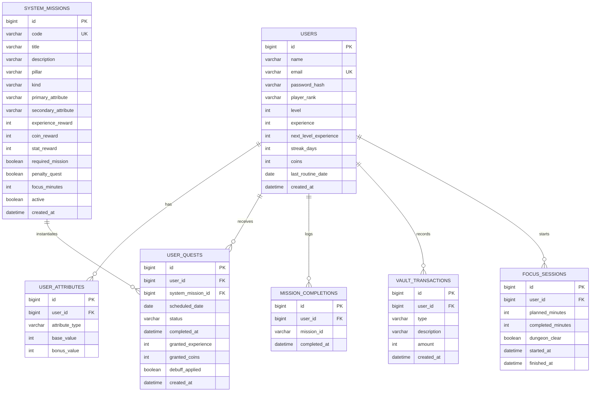

# The System - DER e arquitetura base

## DER conceitual

## Como os modulos se conectam

- `users`: identidade do jogador, rank, nivel, streak e moedas.
- `user_attributes`: stats persistidos por usuario, para treino, estudos, tarefas e vida espiritual.
- `system_missions`: catalogo mestre de quests, penalty quests, dungeon runs e quests lendarias.
- `user_quests`: instancia diaria da rotina gerada para o usuario, com status e recompensa concedida.
- `mission_completions`: legado simples do fluxo atual; pode coexistir durante a migracao.
- `vault_transactions`: ledger do modulo `The Vault`.
- `focus_sessions`: historico do Pomodoro/Dungeon Run.

## Regras de negocio sugeridas

- `Treino -> Strength + Vitality`
- `Estudo -> Intelligence`
- `Responsabilidades -> Agility`
- `Social/Igreja -> Spirit`
- Se uma `required_mission` expirar como `FAILED`, o sistema gera `penalty_quest = true` no proximo ciclo.
- Rank recomendado:
  - `E`: nivel 1
  - `D`: niveis 2-3
  - `C`: niveis 4-5
  - `B`: niveis 6-7
  - `A`: niveis 8-9
  - `S`: niveis 10-29
  - `S2`: niveis 30-49
  - `SSS+`: nivel 50+

## Expansao mobile/PWA

- `focus_sessions` e `user_quests` sao a base ideal para notificacoes push.
- `vault_transactions` suporta economia, loja, consumiveis e itens de streak protection.
- O frontend deve consumir cards compactos e modais de 2 cliques no maximo por acao critica.
